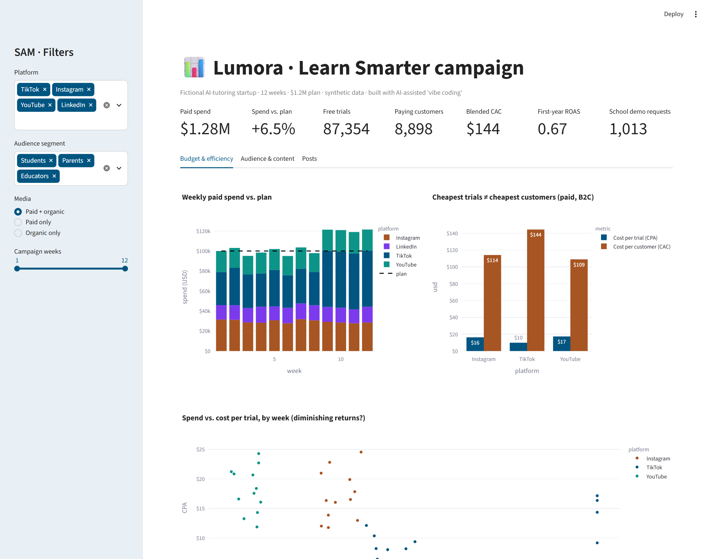

# SAM: Vibe Coding in the Business Classroom

**S**ocial Medi**a** **M**anagement Toolkit: demo programs, Colab notebooks, exercises and templates for a
project-based course in which business students build a real marketing-analytics product by guiding AI coding
assistants in plain English.

🌐 **Course site:** <https://yixin-ylu.github.io/sam-vibe-coding/>



## The case

**Lumora** (fictional) is an AI-tutoring startup running **"Learn Smarter"**, a 12-week, **$1.2M** back-to-school
campaign on TikTok, Instagram, YouTube and LinkedIn aimed at **students** (users), **parents** (payers) and
**educators** (B2B school licenses). The synthetic data hides graduate-level questions to uncover: CPA vs. CAC vs.
B2B pipeline, a student-data privacy incident in week 7, diminishing returns from overspending, and an A/B test with
a compliance catch. → [`data/README.md`](data/README.md)

## Run everything in Google Colab (no installation)

| # | Demo | Business question | AI API | Open |
|---|---|---|---|---|
| 1 | Prompt → tested code | Which channel is really paying off? | none | [](https://colab.research.google.com/github/yixin-ylu/sam-vibe-coding/blob/main/notebooks/01_prompt_to_code.ipynb) |
| 2 | Collect data from a real API | How do competitors post? | none | [](https://colab.research.google.com/github/yixin-ylu/sam-vibe-coding/blob/main/notebooks/02_collect_data.ipynb) |
| 3 | Campaign dashboard | Where is the budget going, and is it working? | none | [](https://colab.research.google.com/github/yixin-ylu/sam-vibe-coding/blob/main/notebooks/03_dashboard.ipynb) |
| 4 | Weekly report + alerts | Are we on budget? What broke this week? | none | [](https://colab.research.google.com/github/yixin-ylu/sam-vibe-coding/blob/main/notebooks/04_automation.ipynb) |
| 5 | Sentiment & issue warning | Did the privacy rumour hurt us? | none | [](https://colab.research.google.com/github/yixin-ylu/sam-vibe-coding/blob/main/notebooks/05_sentiment.ipynb) |
| 6 | Ad copy & comment classification | Compliant copy per audience; what are people complaining about? | **Gemini (free)** | [](https://colab.research.google.com/github/yixin-ylu/sam-vibe-coding/blob/main/notebooks/06_gemini_basics.ipynb) |
| 7 | Campaign-strategy agent | How should we spend the next $400k? | **Claude** | [](https://colab.research.google.com/github/yixin-ylu/sam-vibe-coding/blob/main/notebooks/07_claude_agent.ipynb) |

Demos 1–5 need no account and no key. Demo 6 needs a free Gemini key; Demo 7 needs a Claude key
(about $0.15–$0.60 per run). Keys go in Colab's 🔑 **Secrets** panel, never in code.

## Or run locally

```bash
git clone https://github.com/yixin-ylu/sam-vibe-coding.git
cd sam-vibe-coding
pip install -r requirements.txt          # Python 3.10+
python demos/01_prompt_to_code/campaign_kpis.py
streamlit run demos/03_dashboard/app.py
```

## What's inside

```
data/              the Lumora case: synthetic posts, comments, budget plan, A/B test (+ generator)
demos/01..07/      demo programs, each with a README and the prompts used to build it
notebooks/         one Colab notebook per demo
exercises/         14-week exercise sequence with acceptance criteria
course-modules/    plug-in modules for other courses + "same recipe, other domains"
templates/         prompt journal, peer-review rubric, user stories, portfolio README
.github/workflows/ GitHub Actions example that runs the weekly report in the cloud
```

## Data & responsible use
All data in `data/` is **synthetic**, and Lumora is a fictional company. Demo 2 reads public posts from organisational
accounts via Bluesky's public API. Do not collect personal data, and read each platform's developer terms before using its API.

## License
Code: MIT. Teaching materials: CC BY 4.0. Please adapt them for your own courses.
